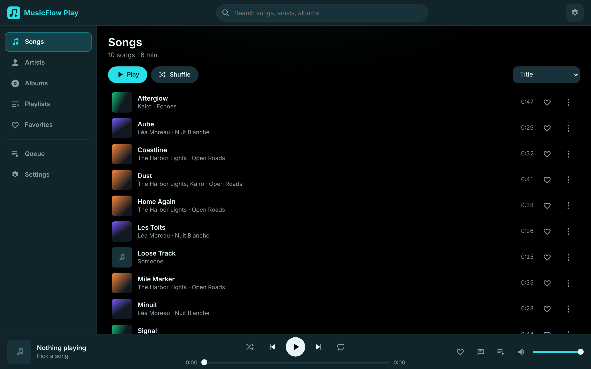
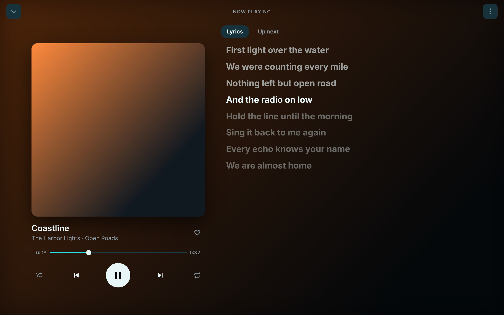
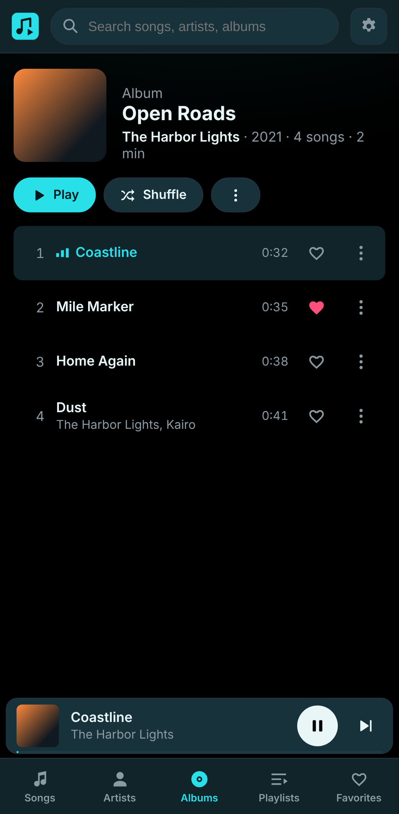
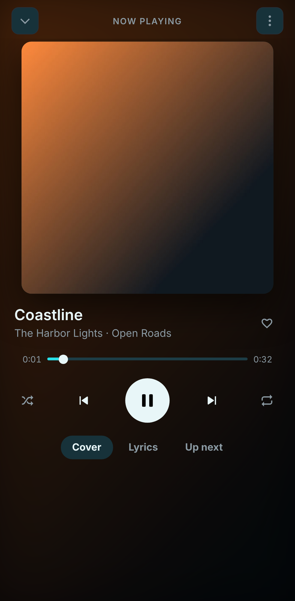

<div align="center">

# MusicFlow Play

**The music player that goes with [MusicFlow](https://github.com/captentv1/musicflow).**
Plays the songs in your folders, with cover art, synced lyrics, playlists and favorites.
PC and Android · free · open source (GPL-3.0) · no account, no ads

</div>

<p align="center">
  
  
  
  
</p>

## Features

- **Library** by songs, artists and albums, subfolders included; search without accents
- **Player**: play/pause, previous/next, shuffle, repeat, queue (play next, reorder, remove)
- **Background playback** with lock-screen, notification and headphone controls (Android), media keys (PC)
- **Synced lyrics** (`.lrc` or tags), tap a line to jump; search online on LRCLIB when a song has none
- **Playlists and favorites**
- **Edit song info** (title, artist, album…), fix albums online from their track list, song details
- **Search online and download** (MusicFlow inside the app): best version, tags, cover and lyrics
- **Import** playlists from a link, your Spotify or YouTube account, your computer (over Wi-Fi) or a file, into one
  root folder; songs already on the device are linked, never downloaded twice
- Formats: MP3, FLAC, WAV, M4A/AAC, Opus, OGG (whatever the browser can play)

## Install

**Android (8.0 or newer, 64-bit)**
1. Download [`MusicFlowPlay.apk`](https://github.com/captentv1/musicflow-play/releases/latest/download/MusicFlowPlay.apk).
2. Open it and allow installing from this source.
3. Allow access to music and notifications. Songs in `Music` and `Download` appear; add other folders in **Settings**.

In **Import**, choose the root folder (e.g. `Music/MusicFlow`) and allow access to all files when asked.

**Windows 10/11**
1. Download [`MusicFlowPlay.exe`](https://github.com/captentv1/musicflow-play/releases/latest/download/MusicFlowPlay.exe).
2. Double-click it: the player opens in your browser. (If Windows shows “Windows protected your PC”: *More info › Run anyway*.)

Search, download and **Import** come from MusicFlow's code inside the player. From source they need
MusicFlow's packages: `pip install -r musicflow/desktop/requirements.txt`.

Other systems: run from source, below.

## Run from source

```bash
git clone --recurse-submodules https://github.com/captentv1/musicflow-play.git
cd musicflow-play
python -m pip install -r requirements.txt
python server/mfp_server.py              # opens http://127.0.0.1:5091
```

On Windows, `run.bat` does the last step. Add your music folders in **Settings** (the default is `Music` in your home folder).

### On your phone, from the computer's library

```bash
python server/mfp_server.py --lan        # or run_lan.bat
```

The server prints a link such as `http://192.168.1.20:5091/?t=…`. Open it on a phone connected to the
same Wi-Fi, then “Add to home screen”. The link contains the key: without it nothing is served.
The music is read from the computer, so the computer stays on.

## How it is built

| Folder | Content |
|---|---|
| `musicflow/` | Git submodule of MusicFlow. Its code is used as is, inside the player's server: `core/`, and its server (`desktop/app.py` on PC, `mobile_app.py` on Android) for search and download. Its page is not used. |
| `server/` | Small Flask server: reads the folders, serves the audio (with seeking), covers, lyrics, playlists and favorites. `downloads.py` is the download queue (songs already on the device are linked), `importer.py` the Import tab (links, Spotify and YouTube APIs, another MusicFlow Play, files), `mf_bridge.py` calls MusicFlow's code. |
| `web/` | The single page, for PC and phone. |
| `android/` | The Android app: a WebView on the same page, the same server run by [Chaquopy](https://chaquo.com/chaquopy/), and a media session for the notification and lock screen. |
| `.github/workflows/build-apk.yml` | Builds the APK, starts it on an Android 12 emulator, plays every format, imports a playlist from a "computer" while playing and swipes the app away (`ci/smoke_test.py`), publishes it as a release on `main`. |
| `tests/` | `python -m pytest tests` (needs `ffmpeg` to make test songs). |

To take a newer MusicFlow: `git submodule update --remote musicflow`, then commit.

Settings, the library index, playlists and favorites are stored in `%APPDATA%\MusicFlowPlay`
(`~/.local/share/musicflow-play` elsewhere). Songs are never changed, except lyrics saved on request.

## Import from Spotify or YouTube

Your playlists are read through the official APIs, with your own (free) developer key, once:

- **Spotify**: [developer.spotify.com/dashboard](https://developer.spotify.com/dashboard) › Create app › Redirect URI
  `http://127.0.0.1:5091/import/callback/spotify`, Web API › copy the Client ID into Import › Spotify.
- **YouTube**: [console.cloud.google.com](https://console.cloud.google.com/apis/library/youtube.googleapis.com) ›
  enable YouTube Data API v3 › OAuth consent screen (External, add yourself as a test user) › Credentials › OAuth
  client ID, type Desktop app › copy the Client ID and secret into Import › YouTube.

A playlist link needs no account.

## Next

- Listen online without downloading (streaming through MusicFlow's search and yt-dlp)

## Build the APK

GitHub Actions builds it on every push. Locally: JDK 17, Android SDK (platform 36), Python 3.13.

```bash
cd android
gradlew assembleRelease           # → app/build/outputs/apk/release/app-release.apk
```

Without `android/keystore.properties` (`storeFile`, `storePassword`, `keyAlias`, `keyPassword`) the APK is
signed with a test key.

## License

GPL-3.0, like MusicFlow.
